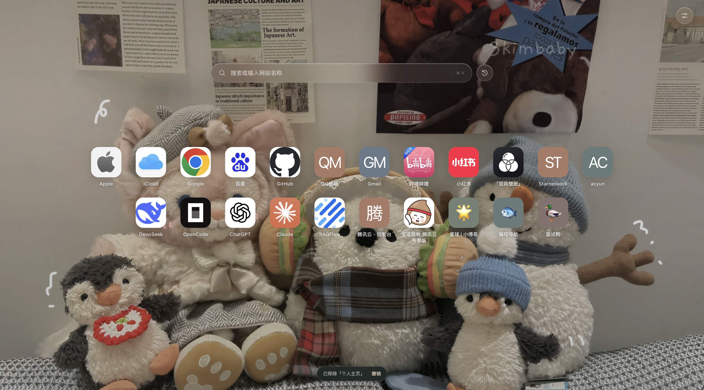
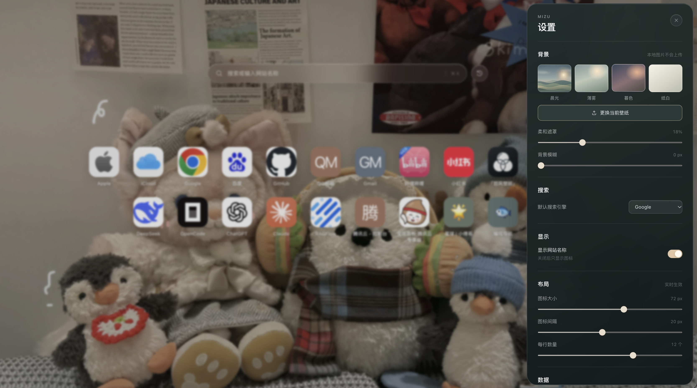

# Mizu

**A wallpaper, a search box, and your favorite sites.**

A clean, customizable new tab extension for Chrome.

[简体中文](README.md) · **English**

[Recent updates](#recent-updates) · [Features](#features) · [Appearance settings](#appearance-settings) · [Installation](#installation) · [Usage](#usage) · [Privacy](#privacy) · [Contributing](#contributing)

## Recent updates

### November 15, 2026 · v0.2.16

- Added JSON backup export and import in settings, covering favorites, icons, wallpapers, order, and all configuration.
- Imports can replace everything or merge favorites; when merging, existing local entries win for duplicate URLs.
- A successful import can be undone for 8 seconds; invalid, oversized, or storage-limited imports leave existing data unchanged.
- Updated the default background to the light bedroom plush wallpaper and switched the interface to its light tone.

## Features

- **A quiet start page** — No news feed, recommendation cards, or account required.
- **Your own background** — Four built-in backgrounds, local image uploads, and adjustable overlay and blur.
- **Favorites within reach** — Save the current page from the toolbar, edit names and URLs, and hold to drag and reorder.
- **Flexible icons** — Website icons or custom text icons, with adjustable size, spacing, and column count.
- **Search and history** — Google, Bing, Baidu, DuckDuckGo, and browser history search.
- **Local storage** — Favorites and settings stay in your browser, with changes reflected across open Mizu tabs.
- **Backup and migration** — Export favorites, icons, wallpapers, and all settings as JSON, then import them on another computer.

## Appearance settings

## Installation

### From a release

1. Download `mizu-start-vVERSION.zip` from this repository's release assets and extract it.
2. Open `chrome://extensions/` and enable **Developer mode** in the top-right corner.
3. Click **Load unpacked** and select the folder containing `manifest.json`.
4. Open a new tab.

Keep the extracted folder in a permanent location: Chrome loads the extension from that directory.

### From source

Clone or download this repository, then load its root directory using the steps above. Mizu uses plain HTML, CSS, and JavaScript, with no dependencies to install or build step.

### Updating

Update the source or replace the files in the existing directory, click Mizu's reload button on the extensions page, and open a new tab. Keep the same directory and extension installation to retain local data; there is no need to uninstall and reinstall.

## Usage

- **Save a favorite:** Click the Mizu toolbar icon on a regular web page, confirm its name, and save.
- **Edit favorites:** Right-click an icon, choose “编辑主页” (Edit home), then click a favorite to change its name, URL, or icon.
- **Reorder:** Hold an icon for about 0.4 seconds and drag, or drag while in edit mode.
- **Customize:** Open settings in the top-right corner to adjust the background and icon layout. Resetting the appearance keeps your favorites.
- **Find a visited page:** Click the history icon beside the search box and search by title or URL.
- **Move to another computer:** Export a backup in settings on the old computer, transfer the JSON file, then import it on the new computer. Choose whether to replace everything or merge favorites.

Favorites and searches open in a new tab in the current window, keeping the start page open. The extension's current interface is in Simplified Chinese.

| Shortcut | Action |
| --- | --- |
| `⌘ K` / `Ctrl K` | Focus the search box |
| `/` | Focus search when not typing in an input |
| `Esc` | Close an overlay or exit edit mode |
| `Alt + ←` / `Alt + →` | Move the focused favorite in edit mode |

## Privacy

Mizu includes no analytics, ads, or cloud sync. Favorites, settings, and uploaded wallpapers are stored locally. Browser history is queried only when the history panel is opened and is not uploaded. JSON backups are created only when requested and remain wherever you choose to save them; they contain favorite URLs, icons, and wallpapers, so store them securely.

Website icons may be requested from their respective sites, and search terms are sent to your selected search engine. See the [privacy and permissions statement](PRIVACY.md) (Chinese) for details.

## Contributing

Issues and pull requests are welcome. For bug reports, include your browser version, operating system, and steps to reproduce.

To develop locally, load the source directory, reload the extension after editing, and open a new tab. Test browser API features in extension mode. See [maintenance and releases](docs/RELEASING.md) (Chinese) for validation, packaging, and automated releases.

## Acknowledgments

Thanks to [PlainTab](https://github.com/kaininx/PlainTab), [SimpTab](https://github.com/Kenshin/simptab), and [Minimalist-New-Tab](https://github.com/zskfree/Minimalist-New-Tab) for design and implementation references.

## License

[MIT License](LICENSE). Third-party brands and website icons belong to their respective owners. See [third-party notices](THIRD_PARTY_NOTICES.md) (Chinese).
