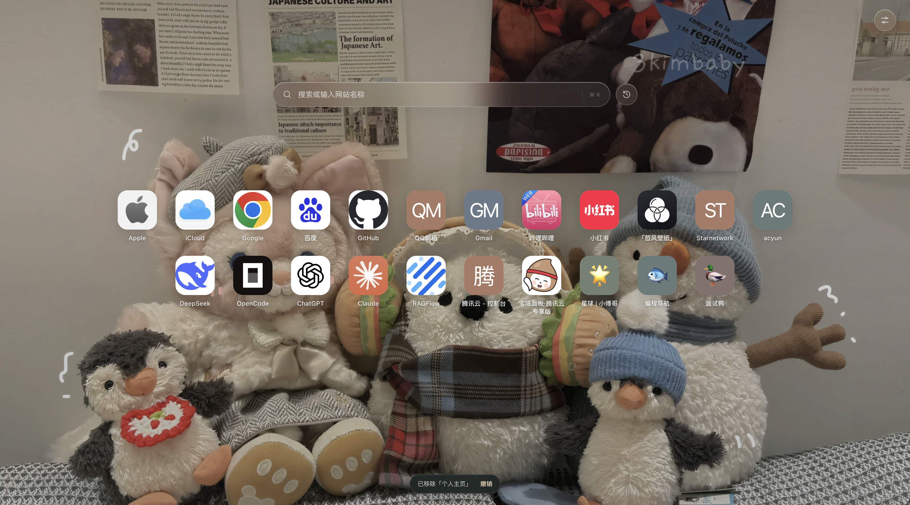
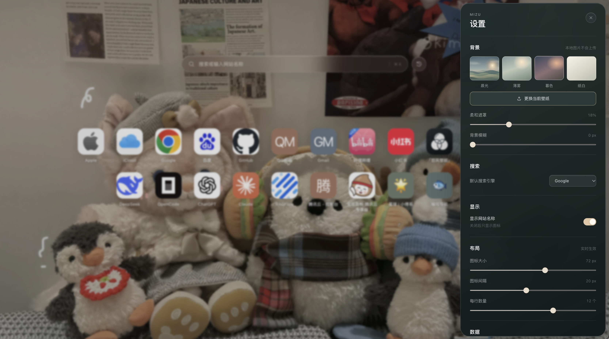

# Mizu

**一张壁纸，一个搜索框，你的常用网站。**

简洁、可自定义的 Chrome 新标签页扩展。

**简体中文** · [English](README.en.md)

[功能](#功能) · [安装](#安装) · [使用](#使用) · [隐私](#隐私) · [贡献](#贡献)

## 功能

- **干净的起始页** — 没有资讯流和推荐卡片，无需注册账号。
- **自己的背景** — 四种内置背景，支持本地图片、遮罩和模糊调整。
- **顺手的收藏** — 从工具栏快速添加当前网页，编辑名称与网址，长按拖动排序。
- **灵活的图标** — 网站图标或自定义文字图标，大小、间距和每行数量自由调整。
- **搜索与历史** — 支持 Google、Bing、百度、DuckDuckGo，以及浏览器历史记录搜索。
- **本地保存** — 收藏和设置保存在当前浏览器中，多个起始页实时更新。

查看外观设置

## 安装

### 从发布包安装

1. 下载本仓库 Release 附件中的 `mizu-start-v版本号.zip` 并解压。
2. 打开 `chrome://extensions/`，启用右上角的 **开发者模式**。
3. 点击 **加载已解压的扩展程序**，选择包含 `manifest.json` 的文件夹。
4. 新开一个标签页。

请将解压后的文件夹保留在固定位置，浏览器需要从中加载扩展。

### 从源码安装

克隆或下载本仓库，按上面的步骤加载仓库根目录即可。使用原生 HTML、CSS 和 JavaScript，无需安装依赖或构建。

### 更新

在原目录更新源码或替换为新版文件，随后在扩展管理页点击 Mizu 的刷新按钮，重新打开新标签页。沿用原目录和现有扩展即可保留本地数据，无需卸载重装。

## 使用

- **添加收藏**：在普通网页点击工具栏中的 Mizu 图标，确认名称后保存。
- **编辑收藏**：右键图标，选择“编辑主页”，再点击收藏修改名称、网址或图标。
- **调整排序**：长按图标约 0.4 秒后拖动，或进入编辑模式后拖动。
- **更换外观**：打开右上角设置，调整背景和图标布局；恢复默认样式不会删除收藏。
- **查找历史**：点击搜索框旁的历史图标，输入标题或网址关键词。

点击收藏或执行搜索会在当前窗口中新开标签页，保留起始页。

| 快捷键 | 操作 |
| --- | --- |
| `⌘ K` / `Ctrl K` | 聚焦搜索框 |
| `/` | 非输入状态下聚焦搜索框 |
| `Esc` | 关闭弹层或退出编辑模式 |
| `Alt + ←` / `Alt + →` | 编辑模式下移动已聚焦的收藏 |

## 隐私

Mizu 不包含统计、广告或云同步。收藏、设置和上传的壁纸保存在本地；浏览历史只在打开历史面板时查询，不上传。

加载网站图标可能请求对应站点，搜索词会发送给所选搜索引擎。详见 [隐私与权限说明](PRIVACY.md)。

## 贡献

欢迎通过 Issues 反馈问题或提交 Pull Request。报告问题时，请提供浏览器版本、操作系统和复现步骤。

本地开发只需加载源码目录；修改后刷新扩展并重新打开新标签页。涉及浏览器接口的功能请在扩展模式下验证。检查、打包及自动发版步骤见 [维护与发版](docs/RELEASING.md)。

## 致谢

感谢 [PlainTab](https://github.com/kaininx/PlainTab)、[SimpTab](https://github.com/Kenshin/simptab) 和 [Minimalist-New-Tab](https://github.com/zskfree/Minimalist-New-Tab) 提供的设计与实现参考。

## 许可证

[MIT License](LICENSE)。第三方品牌与网站图标的权利属于各自权利人，详见 [第三方素材说明](THIRD_PARTY_NOTICES.md)。
